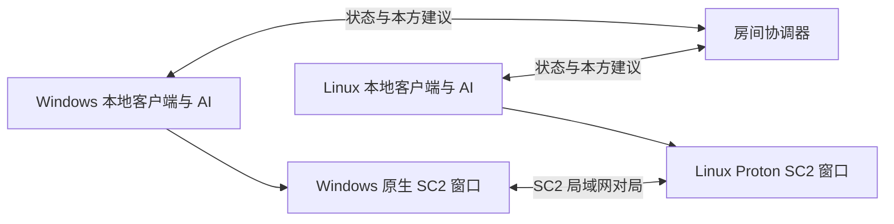

# 局域网双端原生 AI 对战

默认模式已改为：双方电脑各自运行一个原生 SC2 窗口、本方 AI 和本地控制器；房间服务器只负责匹配、配对、地图/版本校验、联机协调及聊天转发。Windows 直接启动本机 SC2，Linux 使用项目现有 Proton 原生窗口环境。游戏画面由本机渲染，不需要视频推流。



浏览器不能直接启动本地可执行文件，因此每位玩家需要在本机运行一次客户端，并保持客户端运行。此后在网页准备、开战和聊天，无须在 SC2 里手工建两场比赛。模型凭据留在各自电脑上，服务器不需要模型账号。

## 准备环境

- 双方安装本项目和 Python 依赖，推荐 Python 3.12。Windows 可在项目目录运行 `py -3.12 -m venv .venv`，再运行 `.\.venv\Scripts\python.exe -m pip install -r requirements.txt`。
- Windows 已安装并运行过原生 SC2，自动读取 `SC2PATH` 或标准安装目录。非标准目录可给客户端加 `--sc2-path "D:\Games\StarCraft II"`。
- Linux 需要已有的项目 Proton 原生环境，沿用 `ARENA_SC2_SOURCE`、`ARENA_PROTON_PATH` 和 `native-runtime/data-copy` 配置；应先确保原有原生对局入口能打开游戏窗口。默认不会用无原生窗口的 Linux API 二进制替代它。
- **两端必须有相同的 SC2 Base build 和 data_version。** 不可直接把 Linux 4.10 API 引擎和 Windows 5.x 游戏混用。协调器会在建房、模型调用之前拒绝不匹配版本；Linux Proton 可以使用与 Windows 相同的 Windows 版引擎。
- 各自在本机配置 `.env` 或已有 OpenCode 登录。`open_api_key` 提供 DeepSeek Go Flash/Pro，`DEEPSEEK_API_KEY` 提供官方 DeepSeek；OpenCode 模型来自本机登录与缓存。网页仅列出本方客户端上报的可用模型，不上传或显示密钥。目录可见不代表已付费验证远端额度/权限。
- 协调器需要项目已验证的 Acropolis 地图及 Slower/Normal 派生地图文件，不需要启动 SC2。地图由协调器发送给两端，下载后核对大小与 SHA256，再通过本机 SC2 API 保存地图。

## 启动房间

协调器可以运行在一名玩家电脑或独立局域网电脑上。

Linux：

```sh
bash start_room.sh --advertise-host 192.168.1.20
```

Windows / PowerShell：

```powershell
.\start_room.ps1 --advertise-host 192.168.1.20
# 如果本机不允许运行 PowerShell 脚本，直接调用 Python：
.\.venv\Scripts\python.exe -X utf8 arena_room.py --open --advertise-host 192.168.1.20
```

`--advertise-host` 必须是本机实际网卡的 IPv4 地址。默认网页端口 8768；两端打开 `http://192.168.1.20:8768/`。多网卡时指定实际 LAN 地址，避免复制到 Docker/VPN/loopback 地址。

## 双方入场、配对和开战

1. 房主创建房间并入座 P1，分享邀请链接或六位房间码。另一位玩家加入 P2。
2. 每位玩家在本方配置卡点击“获取本机客户端配对码”，选择 Windows 或 Linux，在**自己的电脑、本机项目目录**运行网页生成的命令。配对码 2 分钟有效、只能使用一次；它不能替代对手的身份。
3. 看到“本机客户端已连接”后，各自选择本机可用的 AI 模型、种族，编辑并保存 1～1200 字符的战术提示词。展开检查系统规则及聊天契约，勾选确认并准备。
4. 双方网页和本地客户端都在线、确认版本最新时，房主开战。任一配置修改会取消双方准备。
5. 协调器先让双方启动本机 SC2，核对引擎、地图和工具契约；再让 P1 的 SC2 创建一场游戏。双方使用同一主机 IP、端口清单和地图加入该场对局；取得两个不同的引擎玩家 ID 后才启动本方模型控制。

网页生成的启动命令类似：

```powershell
# Windows
.\start_client.ps1 --server http://192.168.1.20:8768 --room ABC234 --pair <网页配对码>
# 不运行 PowerShell 脚本时的等价命令：
.\.venv\Scripts\python.exe -X utf8 arena_client.py --server http://192.168.1.20:8768 --room ABC234 --pair <网页配对码>
```

```sh
# Linux，默认使用 Proton 原生窗口
bash start_client.sh --server http://192.168.1.20:8768 --room ABC234 --pair <网页配对码>
```

多网卡时给客户端添加 `--lan-ip 本机LAN-IP`。SC2 控制 API 始终只监听本机 `127.0.0.1`，不向局域网暴露无鉴权的控制端口。

除了网页端口，还需要两台玩家电脑之间允许 SC2 游戏通信：默认 **15000～15003，TCP/UDP**。协调器可用 `--game-port-base` 指定其他连续四个端口。网页能打开只证明 HTTP 连通，不能证明游戏端口已放行；加入超时会明确停止，不改成两个本地游戏或偷偷改用其他模型。

## 战斗画面、提示词和聊天

- 每位玩家观看和操作自己的原生 SC2 窗口/镜头，保留正常战争迷雾。AI 只连接本机控制器并读取本方观察，不读取对手控制器。
- 浏览器在本方公开决策下显示对话框，建议经协调器转到本方客户端，再进入既有 `OperatorAdvice`。同 ID 去重，下一轮正常决策读取；思考中的请求不受打断，不为聊天另发模型请求。失败重试仍使用原 ID，待处理最多32条，每条最多1000字符。
- “模型已收到”只表示本方模型请求成功返回；采纳、合法执行和战术成功需分别看决策、反馈与实际画面。已停止接收建议的指挥官不会因为网页聊天而突破预算或恢复请求。
- 提示词完整作为 `prepared_strategy` 发送；工具契约只读，运行时还加入本族科技目录、游戏知识和本方观测。使用单主指挥及内置工具，不加载隐藏库战术、固定开局或后台技能开发。
- 对手不能读取本方提示词、决策、聊天、原始日志或客户端错误详情。客户端上报的失败不会被当作对手胜利。原生结果、主动认输规则、停止和未知结果分开记录。

## 重连、停止和历史

浏览器刷新保留席位，关闭网页不停止本机客户端或游戏。客户端持续给协调器发心跳；短暂断线不重复启动游戏。客户端持续失联或协调器持续不可达时停止并保留未知结果，不能凭失联判胜。客户端进程本身崩溃后不自动重开一场；需要关闭遗留的本机 SC2 窗口并重新建立房间/配对。

房主可从网页结束整场，协调器请求两端各自保存回放并退出；客户端 Ctrl+C 只关闭自己拥有的游戏/模型进程。回放保存成功与否以本机记录为准。

- 协调器记录：`launcher-runtime/lan/native-rooms/`、`launcher-runtime/lan/native-matches/<session>/`。
- 各玩家记录：本机 `client-runtime/matches/<session>/`，含确认配置、私有模型记录、feedback/聊天、请求计数、结果和回放。
- 每场 `requests.json` 在联系模型前持久化 attempted，包含失败尝试；已有账本拒绝重新初始化覆盖。模型自带的成功计数不能代替总尝试数。
- 邀请链接仅有房间码。网页身份、一次性配对码、本地客户端令牌分别授权，不能互相替代。
- 已有 bot 战役、Go 系列、历史计数及回放不重置、不覆盖。过期旧房间会在新开局前核验，避免遗留的“进行中”状态永久卡住后续房间。

旧的集中式版本仅保留为 `--central` 兼容入口；默认不再在服务器运行双方游戏。

## 验证范围

`test_distributed_room.py`覆盖一次性配对、私有模型目录、身份权限、版本/地图/工具契约不匹配、唯一建房者、相同对局参数、失联、幂等、双向消息隔离、停止接收建议、Windows 进程清理/凭据过滤分支等。Windows 分支目前是本地模拟测试，不冒充真实 Windows 运行验证。

```sh
.venv/bin/python -m unittest test_distributed_room test_lan_room test_lan_room_worker test_launcher test_operator_advice
# 有 Linux SC2 API 验证环境时，零模型调用的真实原生集成检查：
./run_sc2.sh .venv/bin/python verify_lan_clients_live.py
```

真实原生集成已在**同一台 Linux 机器**上通过：真实 HTTP 协调器、两个独立 LocalClient、两个独立 SC2 进程，各只有一个控制器；双方从12工训练到13工，双向网页建议分别进入本方 Commander 的后续请求，0原生动作错误，两份回放均保存。使用明确标记的本地夹具模型，0外部推理调用，不计比赛胜场。最终证据为 `logs/lan-full-native-k7gysjvj/result.json`，每端请求账本为3次夹具调用、3次成功，均已核对。

Chromium 两个独立浏览器会话通过配对命令、Windows/Linux 模拟客户端、本方模型目录、提示词确认、准备/联机阶段、私有决策/聊天、刷新与390px布局；截图和结果在 `logs/lan-native-browser-preview/`。此浏览器验收的客户端报告是模拟的。

**尚未在两台真实 Windows/Linux 电脑上联测**，真实 GPU 窗口、跨机防火墙/网卡及版本组合仍需用实际两端确认。不能把上述本机双进程或 Windows 分支模拟说成双机跨系统已经通过。

最终相关范围运行674项，672通过、2项原有占位跳过；记录在 `logs/lan-native-final-regressions.log`。十个旧历史账本哈希一致，上一批请求仍181次。
